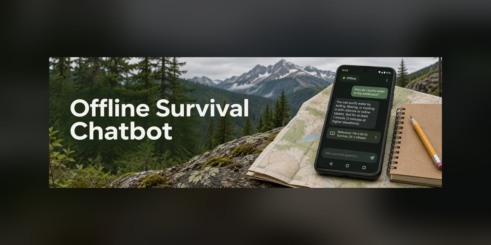

# Offline Survival Chatbot




**An offline-first Android chatbot for finding practical guidance in a searchable survival reference library.** It combines a compact on-device language model with the Essentials collection from [Survival LLM](https://github.com/anonnerdfrenzy/survival-llm). Once installed and set up, chat and reference lookup work without a network connection.

**[Download the Android APK (v0.03)](https://github.com/benclawbot/Offline-survival-chatbot/releases/download/v0.03/Offline-Survival-Chatbot-v0.03.apk)** · [Release notes and checksum](https://github.com/benclawbot/Offline-survival-chatbot/releases/tag/v0.03)

> **Important:** This is an experimental reference aid, not an emergency service or a substitute for professional medical, rescue, or safety advice. A small language model can misunderstand questions or produce incorrect guidance. In immediate danger, contact local emergency services when possible and follow official instructions.

## Why use it?

Phones are useful during travel, outages, and remote trips, but online search can fail when connectivity is weak or unavailable. This app keeps both the model and its reference library on the device, so you can ask plain-language questions and search prepared source material locally.

It is designed for people who want a portable reference for preparedness and practical topics, and who prefer a self-contained sideloaded app over a cloud chatbot or app-store installation. It does not send chat text to a server and the build requests no internet permission.

## Main features

- **On-device chat:** Runs Qwen 3 0.6B through LiteRT-LM on Android. The model is included in the APK; there is no separate model download.
- **Offline reference search:** Searches the Essentials FTS5/BM25 index on-device, retrieves passage text from the included data shards, and returns article title, source, URL, and license information to the chatbot.
- **Prepared survival and health material:** The Essentials collection includes emergency preparedness, first aid and emergency medicine, medical references, food and water safety, travel health, survival manuals, field sanitation, canning, repair, and appropriate technology material. See the bundled `SOURCES.md` for source and license details after first launch at the app data location.
- **All-in-one sideload:** One APK contains the app, model, and compressed reference library. Google Play is not required.
- **Private by default:** Chat and search run locally. The APK omits the Android internet permission; network search is unavailable.
- **Document support:** The base chat UI supports adding local documents to a conversation.
- **Source-aware answers:** The system prompt asks the model to search local references for survival, medical, first-aid, and safety questions and cite retrieved source titles and URLs.

## Included library

The app bundles the **Essentials** pack from Survival LLM, release `library-2026-10-28`. The downloaded archive is approximately 1.28 GB; its extracted content is approximately 3.23 GB. The APK also includes the model, so first-run setup copies the model and extracts the library into app-private storage. Keep the app open while this happens. Later starts use the installed files.

The library is primarily English-language. It is a curated offline collection, not the full web or full Wikipedia. Source content carries the licenses and attribution described in the bundled `SOURCES.md`; sources have different terms.

## Device and installation

- Android 12 or newer (minimum API 31)
- 64-bit ARM device recommended; built for `arm64-v8a`
- Allow installation from the file manager/browser used to open the APK
- APK size: approximately 1.99 GB
- Plan for several gigabytes of free space for Android’s app install and the extracted model and library; leave additional room for the OS and your other apps

Download the [v0.03 all-in-one APK](https://github.com/benclawbot/Offline-survival-chatbot/releases/download/v0.03/Offline-Survival-Chatbot-v0.03.apk), install it, then open **Offline Survival Chatbot** and leave it open through the first-run extraction. The bundled model loads automatically afterwards. The release APK is signed with a debug certificate for direct sideloading. It has a different signing key from v0.02, so uninstall v0.02 before installing it; uninstalling removes that version’s chats and app data. It is suitable for installation, but future updates signed with a different key will not install over it; uninstalling first removes app data.

## How local search works

For each question, the app searches the library’s included SQLite FTS5 index using a bundled SQLite engine, and supplies matching passages to the model. It tokenizes the question into search terms, queries the index with BM25 ranking, reads the matching passage bytes from the corresponding text shard, and adds those passages—with their title, source, URL, and license—to the assistant’s tool result. This is lexical search, not a separately bundled vector embedding model; exact terminology in the question can affect retrieval quality.

## Build from source

Requirements: JDK 21, Android SDK with platform 35 and build tools 35.0.0, and sufficient disk space for the APK assets.

First fetch the pinned, checksum-verified model and Essentials pack, then build:

```bash
bash scripts/fetch-offline-assets.sh
bash gradlew :app:assembleDebug
```

The binary assets and APK are intentionally excluded from Git history because they total multiple gigabytes. The all-in-one APK and its SHA-256 checksum are available in the v0.03 release.


## Upstream projects and data

- App foundation: [LocalChat](https://github.com/NeuroMarshal/LocalChat)
- Survival reference library: [Survival LLM](https://github.com/anonnerdfrenzy/survival-llm)
- Runtime: [LiteRT-LM](https://github.com/google-ai-edge/LiteRT-LM)
- Model: [Qwen 3 0.6B, LiteRT community build](https://huggingface.co/litert-community/Qwen3-0.6B)

The application source inherits the base project’s Apache License 2.0; see [`LICENSE`](LICENSE) and [`NOTICE`](NOTICE). Model and library data have their own licenses and terms. Refer to the included library attribution file and upstream model card before redistribution.
